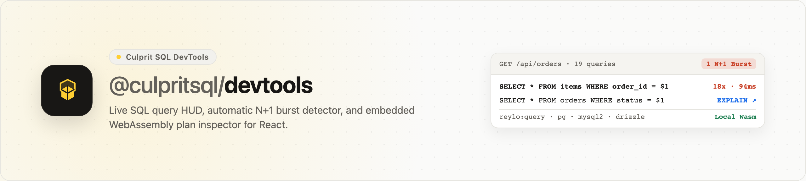

<div align="center">

<picture>
  <source media="(prefers-color-scheme: dark)" srcset="https://raw.githubusercontent.com/culpritsql/culprit-devtools/main/assets/hero-dark.png">
  <source media="(prefers-color-scheme: light)" srcset="https://raw.githubusercontent.com/culpritsql/culprit-devtools/main/assets/hero-light.png">
  
</picture>

<br />

[](https://www.npmjs.com/package/@culpritsql/devtools)
[](https://react.dev)
[](https://nodejs.org)
[](https://www.typescriptlang.org)
[](./LICENSE)

**In-app SQL DevTools HUD, automatic N+1 burst detector, and interactive `EXPLAIN` plan inspector for React and Node.js.**
<br />
Powered by [`@culpritsql/plans`](https://github.com/culpritsql/culprit-plans) WebAssembly and [`@culpritsql/plan-viewer`](https://github.com/culpritsql/culprit-plan-viewer).

[Quickstart](#quickstart) · [Integrations](#framework--driver-integrations) · [React HUD](#react-hud--drawer) · [Server Collector](#server-collector--security) · [API](#subpath-exports)

</div>

---

## Highlights

- **Floating SQL HUD (`⚡ SQL · 12 · 1 N+1`)**: Live query counter with green/amber/coral health dot and docked drawer (`Queries` · `N+1 Bursts` · `Plan Inspector`).
- **Automatic N+1 burst detection**: Canonical SQL fingerprinting strips comments, literals, `$1`/`?`/`:param`, and `IN (?, ?, ...)` lists to group repeated queries per HTTP request and suggest `JOIN` or `WHERE id = ANY($1)` batching fixes.
- **Request correlation (`AsyncLocalStorage`)**: Tags every SQL query executed inside a route handler with its HTTP route badge (`GET /api/orders`).
- **Zero-dependency driver & `diagnostics_channel` hooks**: Native support for **Reylo** (`reylo:query`), `pg`, `mysql2`, `better-sqlite3` / `node:sqlite`, Prisma, and Drizzle.
- **Safe auto-`EXPLAIN` + instant paste**: Runs read-only `EXPLAIN` on slow single-statement `SELECT` queries via `@culpritsql/plans` Wasm, or paste any PostgreSQL, MySQL, MariaDB, SQLite, YugabyteDB, or SQL Server `.sqlplan` output directly inside the drawer.
- **Strict CSS & bundler isolation**: Scoped to `.culprit-dt` (never mutates host `body` or `<button>` styles), and Node builtins live strictly behind `@culpritsql/devtools/server`.

---

## Quickstart

```sh
npm install @culpritsql/devtools
```

### 1. Instrument your server & expose `/__culprit`

```ts
// lib/devtools.ts (Node.js server)
import { Pool } from "pg";
import {
  CulpritCollector,
  createDevtoolsHandler,
  instrumentPg,
} from "@culpritsql/devtools/server";

export const sqlCollector = new CulpritCollector({
  slowThresholdMs: 20,
  nPlusOneThreshold: 5,
});

// Optional: capture Reylo, pg, and mysql2 diagnostics_channel events automatically
sqlCollector.subscribeDiagnosticsChannels();

export const pool = instrumentPg(new Pool({ connectionString: process.env.DATABASE_URL }), {
  collector: sqlCollector,
  autoExplain: true,
});

export const devtoolsHandler = createDevtoolsHandler(sqlCollector);
```

### 2. Mount `<CulpritDevtools />` in your React layout

```tsx
// app/layout.tsx or src/App.tsx
import { CulpritDevtools } from "@culpritsql/devtools/react";
import "@culpritsql/devtools/styles.css";

export function DevOverlay() {
  if (process.env.NODE_ENV === "production") return null;
  return <CulpritDevtools endpoint="/__culprit" position="bottom-right" theme="dark" />;
}
```

---

## Live Full-Stack Playground

Run the zero-Docker SQLite + React 19 + WebAssembly playground in [`demo/`](./demo) to trigger live N+1 query bursts, compare batched fixes, emit `reylo:query` `diagnostics_channel` telemetry, and inspect interactive `EXPLAIN` flow graphs:

```sh
git clone https://github.com/culpritsql/culprit-devtools.git
cd culprit-devtools && bun install && bun run demo
# Open http://127.0.0.1:4321
```

---

## Framework & Driver Integrations

### Reylo (`diagnostics_channel`)

Reylo emits structured query telemetry on `reylo:query`. Subscribe once at startup to capture timings, row counts, parameters, and request correlation with zero wrapper code:

```ts
import { CulpritCollector } from "@culpritsql/devtools/server";

export const collector = new CulpritCollector();
collector.subscribeDiagnosticsChannels(["reylo:query"]);
```

### Next.js App Router

```ts
// app/api/__culprit/[...slug]/route.ts
import { createDevtoolsHandler } from "@culpritsql/devtools/server";
import { sqlCollector } from "@/lib/devtools";

const handler = createDevtoolsHandler(sqlCollector, { basePath: "/api/__culprit" });

export const GET = handler;
export const POST = handler;
```

Wrap Route Handlers or Server Actions with `sqlCollector.withRequest("GET /api/orders", () => ...)` and point `<CulpritDevtools endpoint="/api/__culprit" />` at the route.

### Hono

```ts
import { Hono } from "hono";
import { CulpritCollector, createDevtoolsHandler } from "@culpritsql/devtools/server";

const collector = new CulpritCollector();
const devtools = createDevtoolsHandler(collector);
const app = new Hono();

app.all("/__culprit/*", (c) => devtools(c.req.raw));
app.use("*", (c, next) => collector.withRequest(`${c.req.method} ${c.req.path}`, next));
```

### Express / Node `http`

`createNodeDevtoolsMiddleware` serves `/__culprit/*` and automatically wraps downstream Express routes in `collector.withRequest("METHOD /path", ...)`:

```ts
import express from "express";
import { CulpritCollector, createNodeDevtoolsMiddleware } from "@culpritsql/devtools/server";

const app = express();
const collector = new CulpritCollector();

app.use(createNodeDevtoolsMiddleware(collector));
```

### `pg`, `mysql2`, and SQLite

```ts
import {
  instrumentPg,
  instrumentMysql,
  instrumentSqlite,
} from "@culpritsql/devtools/server";

const pgPool = instrumentPg(rawPgPool, { autoExplain: true });
const mysqlPool = instrumentMysql(rawMysqlPool, { autoExplain: true });
const sqliteDb = instrumentSqlite(rawBetterSqlite3Db, { autoExplain: true });
```

### Drizzle ORM & Prisma

```ts
import { drizzle } from "drizzle-orm/node-postgres";
import { sqlCollector, pool } from "./devtools";

// Passing an instrumented pg pool captures exact execution timings + auto-EXPLAIN:
export const db = drizzle(pool);

// Or attach a lightweight Drizzle logger directly:
export const loggedDb = drizzle(rawPool, {
  logger: sqlCollector.createDrizzleLogger("postgres"),
});

// Prisma client query event hook:
prisma.$on("query", (event) => {
  sqlCollector.recordQuery({
    sql: event.query,
    durationMs: event.duration,
    params: event.params,
    engine: "postgres",
  });
});
```

---

## React HUD & Drawer

`<CulpritDevtools />` works with live polling (`endpoint="/__culprit"`), SSR (`initialSnapshot`), or completely offline in Storybook and tests (`snapshot={...}`).

| Prop | Type | Default | Description |
| --- | --- | --- | --- |
| `endpoint` | `string` | `"/__culprit"` | Base URL for `/snapshot`, `/clear`, and `/parse` |
| `snapshot` | `DevtoolsSnapshot` | `undefined` | Controlled snapshot (disables background polling) |
| `initialSnapshot` | `DevtoolsSnapshot` | `undefined` | Initial data for SSR and first client paint |
| `pollIntervalMs` | `number` | `1500` | Polling cadence in ms (`<= 0` disables polling) |
| `position` | `"bottom-right" \| "bottom-left" \| "top-right" \| "top-left"` | `"bottom-right"` | Corner placement for the floating trigger pill |
| `theme` | `"dark" \| "light" \| "system"` | `"dark"` | Theme applied to the drawer and `<PlanViewer />` |
| `defaultOpen` | `boolean` | `false` | Render with the drawer open initially |
| `defaultTab` | `"queries" \| "bursts" \| "plan"` | `"queries"` | Initial drawer tab |

---

## Server Collector & Security

- **Disabled in production by default**: `CulpritCollector` becomes a zero-allocation no-op when `NODE_ENV === "production"`, and `createDevtoolsHandler` returns `403 Forbidden` unless `allowProduction: true` is explicitly configured.
- **Loopback-only guard**: `createDevtoolsHandler` and `createNodeDevtoolsMiddleware` reject non-loopback `Host`, `X-Forwarded-For`, and socket addresses (`403 Forbidden`) unless `allowRemote: true` is passed.
- **Read-only `autoExplain` guard**: Auto-`EXPLAIN` runs strictly on single-statement `SELECT` / `WITH ... SELECT` queries containing zero data-modifying keywords, tagged with `/* culprit */` so explain queries never recurse.

---

## Subpath Exports

| Import Path | Environment | Exports |
| --- | --- | --- |
| `@culpritsql/devtools` | Browser / SSR / Universal | `CulpritDevtools`, `normalizeSqlForFingerprint`, `fingerprintSql`, `detectNPlusOneAdvice`, shared types |
| `@culpritsql/devtools/react` | Browser / SSR | `CulpritDevtools` and React prop types |
| `@culpritsql/devtools/server` | Node.js / Bun (`>=20`) | `CulpritCollector`, `createDevtoolsHandler`, `createNodeDevtoolsMiddleware`, `instrumentPg`, `instrumentMysql`, `instrumentSqlite`, `parseExplainText` |
| `@culpritsql/devtools/styles.css` | CSS | Scoped `.culprit-dt` + `@culpritsql/plan-viewer` styles |

## License

MIT
